# OpenSky VFR

OpenSky is an open-source, free-roam VFR flying sandbox. Take a Cessna 172S from Castejón de Sos (`ES-0205`), explore the Pyrenees and nearby regions, and make each new airfield your temporary base by landing and parking there.

The game is built around unhurried exploration rather than missions or ownership progression. The World map is for browsing and planning: selecting an airport or drawing a route never relocates the aircraft. A successful parking action saves the new base. The save keeps the aircraft's location, heading, condition, fuel and logbook; leaving before parking keeps the previous base.

## Project status

- **Supported development runtime:** C++20, OpenGL 4.6, Linux/X11/GLX.
- **Aircraft simulation:** upstream JSBSim, dynamically linked under LGPL; the game advances it at 120 Hz independently of rendering.
- **Release scenery baseline:** Aragón and Catalunya are included together in the standard game.
- **Windows 11:** a supported build and installer are not available yet.
- **Open-source release:** see the [release checklist](docs/OPEN_SOURCE_RELEASE.md) and [third-party notices](THIRD_PARTY_LICENSES.md).

## Screenshots

Captured in OpenSky at 1920×1080 with Ultra quality and a 200% terrain LOD radius. Aerial imagery © Instituto Geográfico Nacional de España (PNOA).

| Castejón de Sos — cockpit | Castejón de Sos — chase view |
|---|---|
| 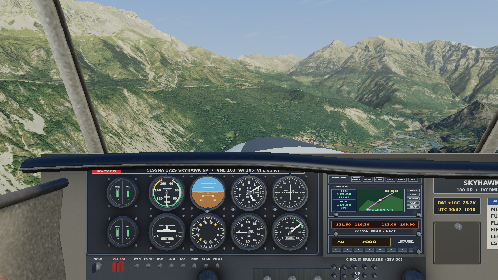 | 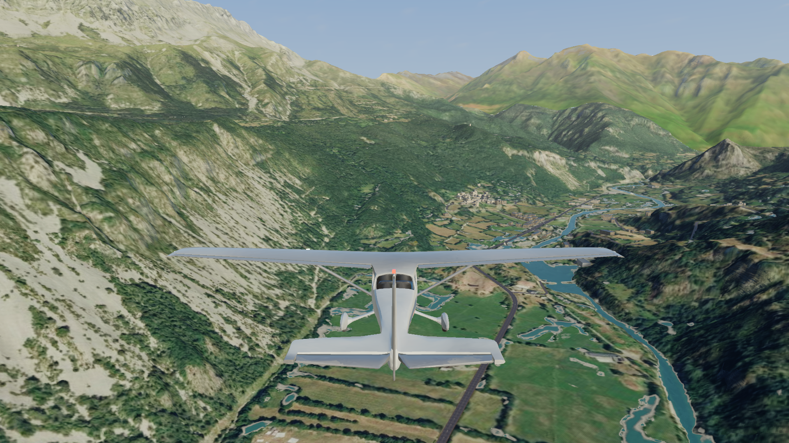 |

| Barcelona coast — cockpit | Barcelona coast — chase view |
|---|---|
| 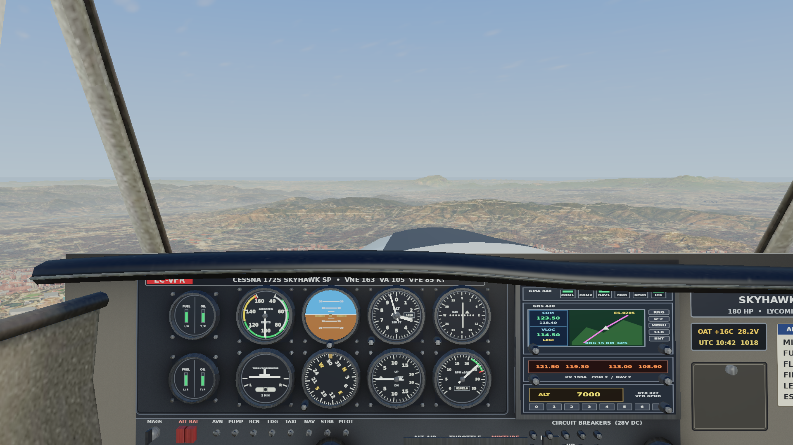 | 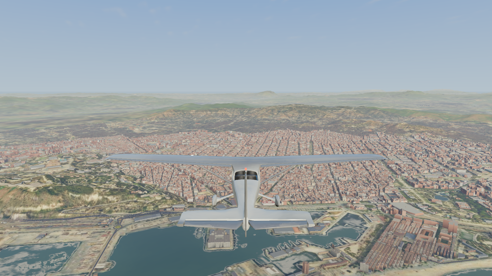 |

| Costa Brava, Begur — cockpit | Costa Brava, Begur — chase view |
|---|---|
| 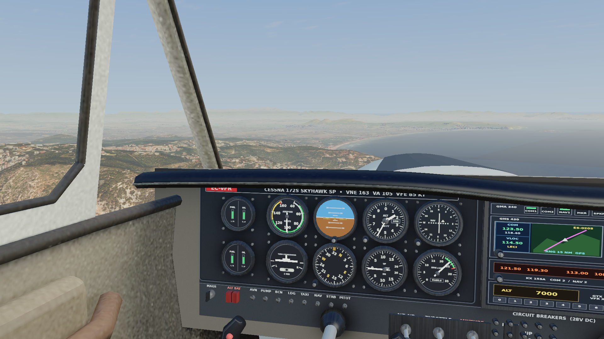 | 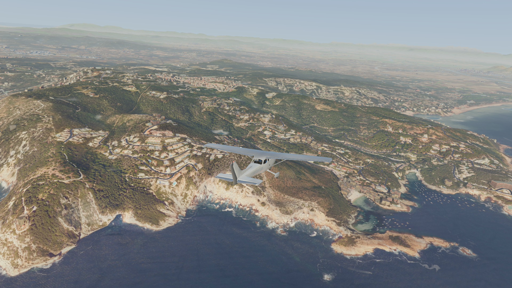 |

| Catalan Pyrenees — cockpit | Catalan Pyrenees — chase view |
|---|---|
| 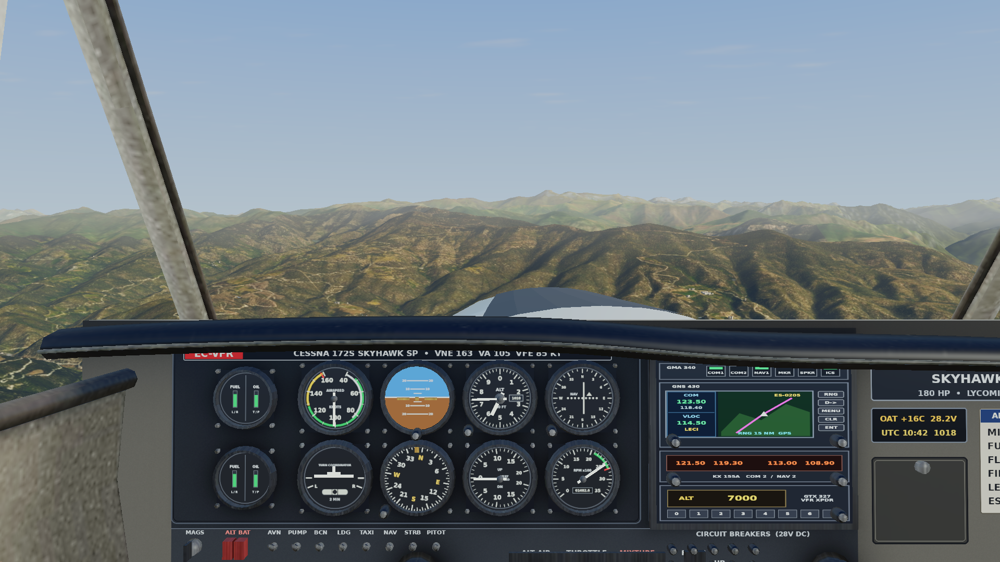 | 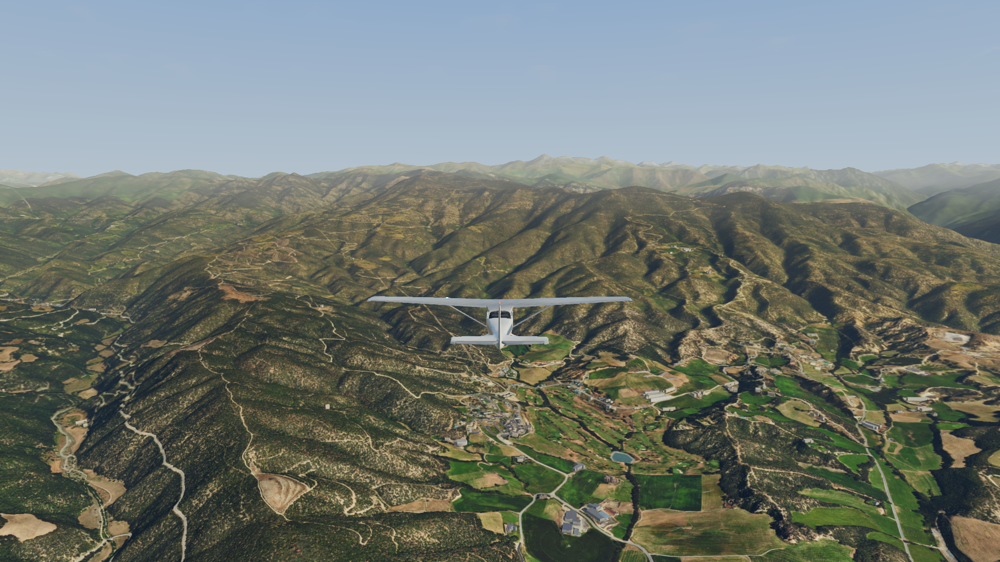 |

| Mediano reservoir — cockpit | Mediano reservoir — chase view |
|---|---|
| 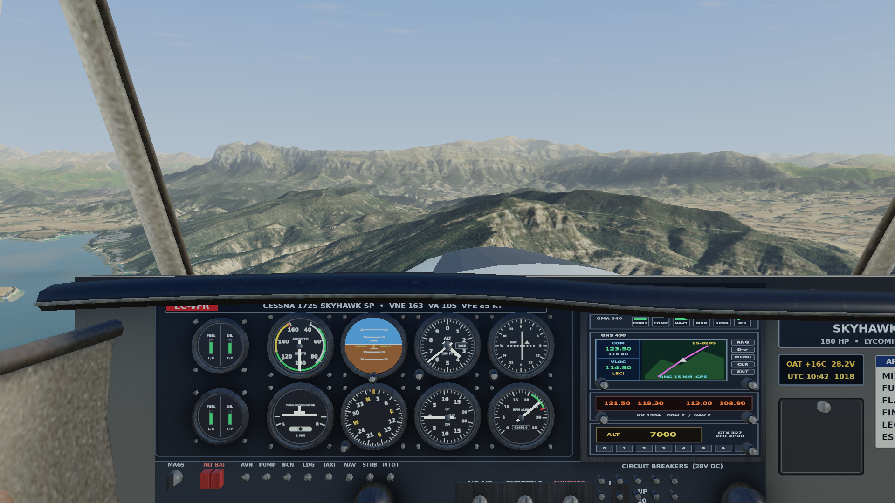 | 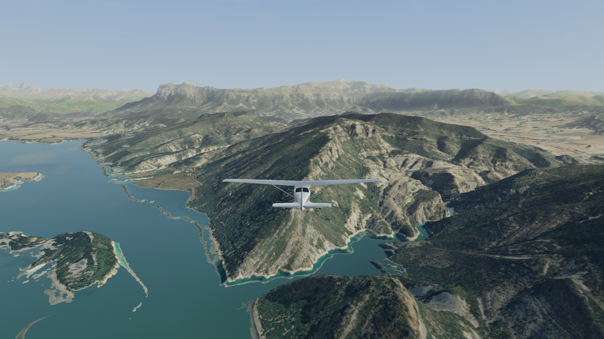 |

### Weather in flight

These scenes use preset inputs to the regional weather model. The first view exposes a published model snapshot as 3D wind vectors across all four altitude layers; marker size shows cloud fraction and blue marks precipitation. Volumetric clouds in the scene use that weather state. The cockpit view shows precipitation reaching the windshield.

| 3D weather-model layers over the Pyrenees | Model-driven rain near Castejón de Sos |
|---|---|
| 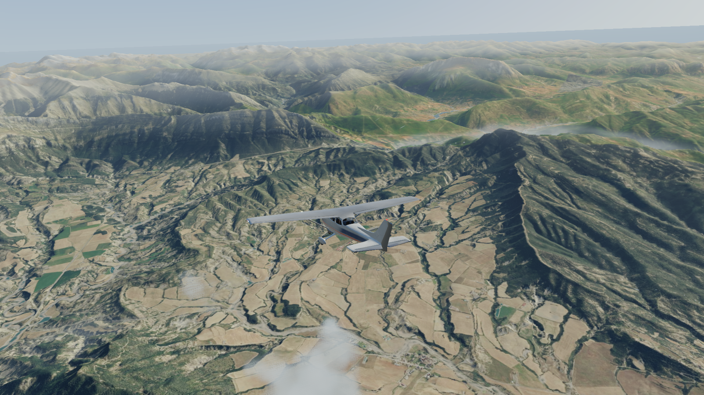 | 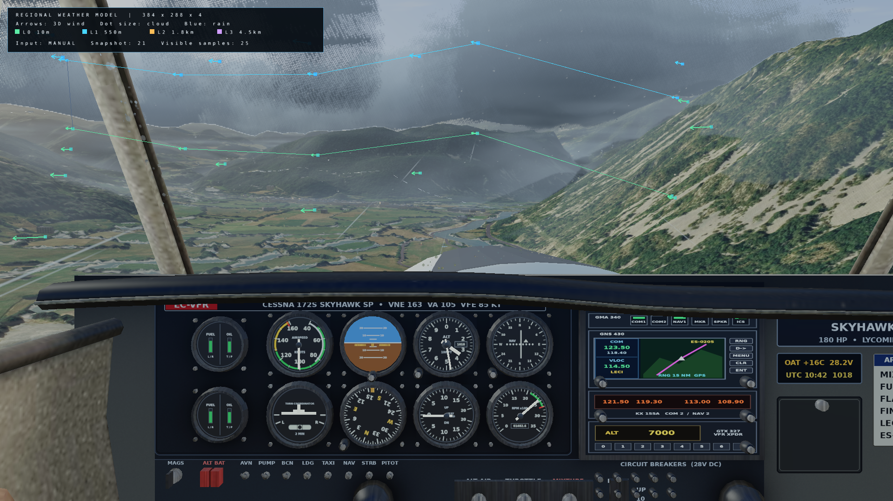 |

### Promo flight video

[Watch the 15-second vertical flight promo](docs/videos/opensky-flight-promo-vertical.mp4). The 9:16 Instagram cut combines orbiting exterior shots and cockpit passes over Aragón and Catalunya, thermal, foehn, winter and storm conditions, and procedural cockpit-perspective C172 audio.

[Watch the 15-second top-down weather-model time-lapse](docs/videos/opensky-weather-model-topdown-vertical.mp4). It shows all four published weather layers from above as wind, cloud and precipitation fields evolve over four and a half simulated minutes, with the model clock, bright layer markers and snapshot generation visible in the debug overlay.

The following 20-second vertical clips each cover six simulated minutes at 24 fps. They show the aircraft-centered 8 km local refinement over terrain in Aragón and Catalunya; the debug panel reports displayed marker spacing separately from the solver's finer cell spacing.

- [Pyrenees valley](docs/videos/opensky-weather-pyrenees-local-20s.mp4)
- [Embalse de Mediano](docs/videos/opensky-weather-mediano-local-20s.mp4)
- [Costa Brava](docs/videos/opensky-weather-costa-brava-local-20s.mp4)

Scenery imagery in these captures: © Instituto Geográfico Nacional de España (IGN), [CC BY 4.0](https://creativecommons.org/licenses/by/4.0/); PNOA imagery has been cropped and rendered in the simulator. Source: [IGN Spain PNOA](https://pnoa.ign.es/pnoa-imagen/visualizadores-y-servicios-web). City and building data © [OpenStreetMap contributors](https://www.openstreetmap.org/copyright), ODbL 1.0.

## Getting started

There is no packaged desktop release yet. Contributors can build the Linux development version from source:

```bash
make -C sim_engine -j"$(nproc)"
./run_sim.sh
```

The build needs a C++20 compiler, CMake, OpenGL development files, X11 development files, and the system dependencies listed in [contributing](CONTRIBUTING.md). Run from the repository root. The source checkout does not contain generated scenery packs; region data is built or installed separately.

On a new save the aircraft is based at Castejón de Sos. Open **World** to explore installed airports and landmarks. Select an airfield or landmark and add route points if you want a plan. Choose **Walk to aircraft** to inspect and board at the saved stand. After landing, taxi clear of the runway, shut down, and use **Esc → Park** to save a temporary base.

The optional live weather boundary feed can be disabled with `./run_sim.sh --no-live-weather`. Online PNOA imagery is controlled separately in Settings or with `./run_sim.sh --online-ortho off`.

A first-flight guide introduces these steps. During flight the interface overlays are hidden by default; turn them back on in **Settings → In-flight overlays**, or press `T` to show the controls guide. Display mode can be set to windowed, fullscreen, or fullscreen windowed in Settings and takes effect after restarting.

## Architecture

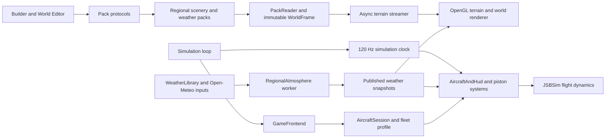

`sim_engine/` owns the player executable, world rendering, asset streaming, interface and runtime coordination. `engine/` contains the JSBSim adapter, aircraft systems and geodesy. `builder/` turns licensed source data into installable scenery and weather packs. `protocol/` defines the pack formats shared by the C++ reader and Python builder. The architecture and thread boundaries are described in [architecture](docs/ARCHITECTURE.md); responsibilities for each runtime system are in [systems](docs/SYSTEMS.md).

## The game engine

OpenSky's goal is that anyone with a laptop can play. The engine targets 60 FPS or better on AMD Radeon Renoir integrated graphics, with higher quality tiers available for discrete GPUs.

The renderer streams nearby terrain pages around the aircraft and reuses them as the player moves. A bounded worker pool reads and prepares pages; GPU uploads are budgeted across frames. The terrain uses CDLOD, array textures, mipmapped imagery, baked relief, weather-aware lighting and distance-based detail. The cockpit is rendered at the output resolution while the exterior scene follows the selected quality tier.

The main loop polls controls, advances simulation time in fixed 1/120-second steps, updates weather and aircraft state, then renders. A render call does not itself move the aircraft forward in simulation time. Region transitions pass through the central world-frame path so delayed terrain and weather jobs cannot publish results for an obsolete region.

See [system descriptions](docs/SYSTEMS.md) for aircraft ownership, terrain streaming, rendering, audio, traffic, saves and QA tools. The maintained source file map is in [file reference](docs/FILE_REFERENCE.md).

## Weather system

Weather displayed as current or historical comes from a published in-game model snapshot. When live input is available, Open-Meteo supplies boundary conditions; the local model then evolves wind, cloud, turbulence and precipitation through four terrain-following vertical layers. The World screen identifies the input source and shows when an airport lies outside model coverage. Outlook runs project the current model at +1, +3 and +5 simulation minutes under fixed inputs.

The regional CPU solver uses a 384 × 288 × 4 grid, roughly 400 m per horizontal cell in the default corridor. Settings can add an 8 km aircraft-following terrain refinement tile at about 42 m or 21 m spacing. The debug animation's accumulated lines are pathlines traced through published wind values; line placement and flow markers do not imply centimetre-scale physics. Resolution limits, snapshot publication and data provenance are covered in [weather system](docs/WEATHER.md).

## Make and install mods

Aircraft are distributed as self-contained folders with a manifest, JSBSim flight data and exterior/cockpit GLB models. The current package format has a shared single-piston systems profile. It does not execute aircraft scripts yet, so a model and scripts alone are not currently a complete aircraft mod. Region mods are `.nspack` files with optional relief, city, scenery and weather companions.

- [Aircraft package format and first package](docs/MODDING.md#aircraft-packages)
- [Building a region pack](docs/MODDING.md#regional-content)
- [Current format limits and the planned script API](docs/MODDING.md#current-limits)

OpenSky is based in Spain, with Aragón and Catalunya together in the baseline release. The World Editor lets users build and install additional licensed regions anywhere in the world. Compatible regions do not change the game's ownership rules. Generated packs, caches and temporary bakes belong outside tracked source.

## Project guides

| Guide | What it covers |
|---|---|
| [Architecture](docs/ARCHITECTURE.md) | Runtime layers, data flow, ownership and thread boundaries |
| [Systems](docs/SYSTEMS.md) | What each game subsystem does and where to change it |
| [Weather system](docs/WEATHER.md) | Inputs, solver, snapshots, rendering, limitations and attribution |
| [Modding](docs/MODDING.md) | Aircraft packages, region packs, installation and current limits |
| [File reference](docs/FILE_REFERENCE.md) | Maintained source, shader, tool, protocol and asset responsibilities |
| [Contributing](CONTRIBUTING.md) | Build workflow, code rules and verification commands |
| [Open-source release checklist](docs/OPEN_SOURCE_RELEASE.md) | Distribution, platform status, asset rights and release checks |

## Controls

| Input | Action |
|---|---|
| `W` / `S` | Increase / reduce throttle |
| `A` / `D` | Roll left / right |
| `↑` / `↓` | Pitch down / up |
| `Q` / `E` | Rudder left / right |
| `X` | Release parking brake; hold for wheel brakes |
| `F` / `V` | Flaps down / up |
| `C` | Cycle cockpit, chase and free camera |
| Right mouse drag | Look around |
| `Esc` / `Space` | Pause and open the World screen |
| `T` | Toggle the in-flight controls guide |
| `F1`–`F4` | Change graphics quality tier |

The in-game **Controls** page lists additional cockpit, camera and system keys.

## Data and licenses

OpenSky uses openly licensed or documented sources and retains required attribution. Inputs include IGN Spain PNOA, MDT05/MDT25 and INSPIRE Hidrografía (CC BY 4.0), OurAirports (public domain), OpenStreetMap (ODbL), Poly Haven (CC0) and Open-Meteo subject to its data and service terms. See [third-party licenses](THIRD_PARTY_LICENSES.md) and the [airport source notes](docs/airport-data-sources.md). Esri imagery, GPL aircraft assets and assets without documented redistribution rights are not allowed in release packages.

Project code and original game assets are MIT licensed. Vendored JSBSim remains under LGPL-2.1; generated OpenStreetMap-derived packs carry ODbL obligations. Each third-party asset and data source keeps its own license and attribution.
