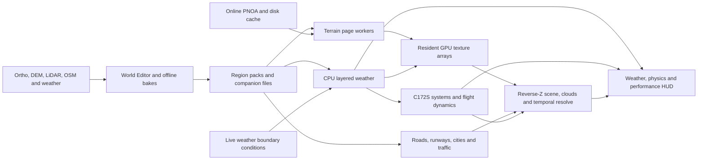

# OpenSky engine audit — Renoir, 23 November 2026

> Historical profiler snapshot taken before the upstream JSBSim runtime migration and weather fixes later on 23 November. Compression and Renoir timing measurements below remain measurements of the earlier build. The active aircraft and weather implementation is described in the [flight and weather audit](2026-11-23_flight-weather-audit.md).

OpenSky targets **1920×1080 High at 60 FPS on AMD Renoir**, with MSFS 2024 as the visual reference and a study-level C172S as the flight-model and cockpit target. The current simulator runs the Aragón pack, streams terrain, renders a weather-driven sky and accepts mouse-yoke input. High presents 1920×1080 from a 1280×720 scene and a 640×360 cloud target. The short captures below expose throughput and pacing bottlenecks. Release qualification requires complete flights and matched visual comparisons.

## Reproduce the profile

```bash
make -C sim_engine -j8
./run_sim.sh -- --profile /tmp/opensky-play
./run_sim.sh -- --quick-profile /tmp/opensky-bc7 --ortho-format bc7
./run_sim.sh -- --quick-profile /tmp/opensky-bc7-fast --ortho-format bc7-fast
./run_sim.sh -- --quick-profile /tmp/opensky-rgba8 --ortho-format rgba8
python3 tools/summarize_profile.py /tmp/opensky-bc7 /tmp/opensky-bc7-fast /tmp/opensky-rgba8
./run_sim.sh -- --quick-profile /tmp/opensky-debug --debug-overlays
./run_sim.sh -- --cockpit-qa /tmp/opensky-cockpit
```

Use fresh output directories for independent runs. Interactive capture ends when the simulator closes normally. The quick capture flies two High routes at a fixed simulation timestep and solar preset, with 30 warm-up frames and 240 measured frames per route. It excludes synchronous scenery drains and records the resulting terrain residency. Runs now use online-first PNOA unless `--online-ortho off` is supplied, so note whether the source cache is cold or warm. `--autotest` includes the full visual sweep, `--season-qa <dir>` captures repeatable four-season canopy/alpine views, and `--autotest <dir> --bench-only` runs the longer four-route, three-tier benchmark.

| Control or trace | What it shows |
| --- | --- |
| **F5** | Rolling frame mean, p95 and p99, CPU cores used by the process, main-thread CPU, resident RAM, GPU busy and device memory when available, pass timings and terrain worker time. |
| **F6** | Cycles off, 10 m, 550 m, 1,800 m and 4,500 m AGL. The north-up grid shows the published CPU cells with cloud, liquid water, rain and ENU wind. Projected arrows show wind at the selected layer in the scene. They remain readable through terrain. |
| **F7** | Aircraft IAS, TAS, AoA, sideslip, coefficients, body rates, actual control inputs, thrust, flap position, electrical and fuel values, and wheel weight-on-wheels and strut travel. Cockpit shows the air-relative flight path. Chase shows body axes, thrust, air path and gear contacts. |
| `startup.csv` | Wall time for pack load and corridor bake, GL context, terrain allocations, world assets, aircraft assets, weather init, coarse prewarm and first present. |
| `frames.csv` | Scene and frame ID, wall time between completed swap calls, CPU input/physics, weather, camera preparation and present duration. Includes page builds, upload counts and bytes, L7–L9 residency, PNOA cache uses and downloads, and cumulative weather worker solve and publication time. |
| `gpu_pass_times.csv` | Asynchronous timestamps and CPU submission cost for uploads, sky, terrain, terrain-depth copy, world, aircraft, clouds/post and HUD. Join with `frames.csv` on `frame`. The query ring samples one frame in four and skips a sample if the GPU still owns its slot. |
| `resources.csv` and `metadata.txt` | Approximately 1 Hz process CPU, main-thread CPU, process RSS and peak RSS, host RAM, DRM device utilization and device-wide VRAM/GTT when supported. One CPU core fully occupied counts as 1.0. Missing counters are `-1`. Metadata records the renderer, output, terrain format and logical allocated bytes. |

GPU timestamps measure work between command-stream markers. CPU submission includes driver calls and can wait on earlier work. Swap duration can include GPU back-pressure, compositing and display scheduling even with the requested swap interval set to zero. Read it alongside the timestamps and host metrics. AMD device counters include other clients. On this UMA laptop the 512 MiB VRAM aperture and system-backed GTT are driver pools, so adding them to RSS would double count some memory. Logical texture bytes are useful for a same-resource comparison. [Khronos timer queries](https://registry.khronos.org/OpenGL/extensions/ARB/ARB_timer_query.txt), [Linux AMDGPU counters](https://docs.kernel.org/6.18/gpu/amdgpu/driver-misc.html)

## Renoir measurements

Ryzen 7 5700U, Radeon Renoir, Mesa 25.0.7, Linux 6.12.116, 1920×1080 High, eight terrain workers, pack imagery, desktop compositor active. Each table row contains 239 measured frame intervals. The final LOD reflects the last measured draw. A fair steady-state GPU comparison requires matching terrain residency.

| Format and route | Mean FPS | p95 / p99 frame ms | Final LOD | Pages built | Worker generation / encode ms per page |
| --- | ---: | ---: | ---: | ---: | ---: |
| BC7, Pyrenees | 82.0 | 20.96 / 21.86 | 4 | 86 | 41.7 / 240.6 |
| BC7, Zaragoza | 72.1 | 19.76 / 21.04 | 4 | 81 | 37.2 / 291.3 |
| BC7 fast, Pyrenees | 102.3 | 16.68 / 16.96 | 3 | 49 | 139.8 / 238.7 |
| BC7 fast, Zaragoza | 71.0 | 20.29 / 21.99 | 4 | 68 | 100.6 / 301.7 |
| RGBA8, Pyrenees | 81.9 | 19.67 / 22.44 | 9 | 272 | 85.7 / 0.0 |
| RGBA8, Zaragoza | 64.1 | 22.41 / 24.30 | 9 | 341 | 84.2 / 0.0 |

- **Compression costs.** The initial instrumented build took about 550 ms per BC7 page in both routes. Its mip generator and encoder read from a write-only persistent PBO. The revised path builds mips and encodes in cached RAM, then copies upload-ready bytes into the PBO. BC7 keeps the same production encoding settings. The measured cost fell to 241–291 ms/page. Runtime encoding remains a substantial throughput limit. The fast mode restricts BC7 to mode 6 and did not consistently improve throughput in these runs. Default flight retains BC7 with the original mode selection.
- **Memory.** BC7 and BC7 fast reserve **183 MiB** of logical GPU terrain array storage. RGBA8 reserves **567 MiB**, a **384 MiB** increase at the same array capacity. The BC7 capture sampled about 1.82–1.87 GiB of device GTT late in the run, versus about 2.26–2.31 GiB with RGBA8. Other GPU clients contribute to both figures. Peak process RSS was 1.11 GiB for BC7 and 1.18 GiB for RGBA8. Compression benefits GPU allocation. In this pipeline the hot encoder can still delay when sharp imagery arrives.
- **Loading.** The current short capture took 10.9 s including startup, both routes and PNG output. First present was 3.01 s in that BC7 run, including 1.14 s of coarse prewarm and 0.96–1.12 s of pack loading and corridor work across the offline cases. The city and aircraft initialization stages took roughly 0.25–0.30 s and 0.15–0.22 s. Selecting the initial anchor before resource setup avoids repeating terrain prewarm for the same corridor. Same-anchor re-anchors now skip the corridor rebake. In the full visual sweep, each view can issue 14 synchronous drains with up to 2.5 s of polling per drain. That workload can dominate time to complete the test. The three-view cockpit-only run completed in 10.30 s with shorter terrain waits. Its terrain can remain coarse, which is appropriate for inspecting the cabin and unsuitable for qualifying scenery.
- **Frame pacing.** In the BC7 run, clouds/post averaged 3.06–3.09 ms GPU, aircraft 1.49–1.63 ms, the terrain-only depth copy 0.31–0.32 ms and Zaragoza world 2.08 ms. RGBA8 spent more GPU time on terrain while drawing finer LODs. Input/physics averaged below 0.2 ms per frame in these captures. Device busy rose into the 90% range during flight and swap/present carried many long intervals. The worker counts and pass timestamps do not isolate the cost of the compositor or recent cloud/cockpit changes. The textured RGBA8 routes also missed the p95 gate.
- **Visual check.** The live RGBA8 Castejón capture resolves the valley floor, field boundaries and slopes more clearly than the cold BC7 capture. The same valley in aerial photos shows readable woodland edges, patchwork fields, settlement details and distinct silhouettes behind the river. The simulator still flattens canopy volume and smooths the distant hillsides. The chase debug capture shows repeatable weather and physics overlays but sparse cloud structure. The aft cockpit capture still exposes terrain through missing cabin coverage. This is a qualitative location comparison without matched camera and lighting. [Aerial Castejón reference](https://www.manawa.com/fr-FR/activite/espagne/benasque/parapente/tandem-paragliding-in-castejon-de-sos-huesca/4120), [Benasque valley and Río Ésera reference](https://www.heraldo.es/noticias/aragon/2019/07/30/turismo-activo-en-el-valle-de-benasque-para-disfrutar-de-la-naturaleza-1325064.html)

An 11.43 s online RGBA8 run with the debug layers active logged 11,670 PNOA cache uses and 74 successful downloads. The cache uses count tile lookups and can include repeat accesses. This confirms source streaming and overlay rendering during the same run.

Raw profiler exports and screenshots from this run are in `/tmp/opensky-renoir-audit.EGwCMI/`. The headless self-test passed. The historical baseline in [Renoir benchmarks](benchmarks/2026-11-23-renoir-linux.md) used different warm-up and route timing and is useful for trend context only.

## What the engine runs



### Terrain, streaming and antialiasing

- **Working path.** CDLOD selects quad patches by frustum, AGL and a flight-path lookahead. Geomorphing and the parent page cover missing children. Four workers decode or resample source tiles into 512×512 ortho pages with six mips, a 67×67 height grid and two 129×129 auxiliary maps. Persistent PBOs stage uploads to 384 array slices. PNOA is preferred at eligible near zooms and flies on pack imagery while requests are pending. Offline tiles get a gentle unsharp pass and deterministic ±3.5% luminance grain for small pages. The scene uses reverse-Z and configurable 1080p reconstruction (pixel budget, AA, mesh LOD radius); cockpit view can render the cockpit after reconstruction at native output resolution. The profiler captures later in this audit predate the cockpit bypass pass. [Pack reader](../sim_engine/src/pack_reader.cpp), [CDLOD](../sim_engine/src/cdlod_terrain.cpp), [Streamer](../sim_engine/src/async_streamer.cpp), [Post shader](../sim_engine/shaders/post_tonemap.frag)
- **Bottleneck.** Every new page goes through resampling and the selected block encoder. The split waits for all four children and a close L9 request can only be discovered after its ancestry becomes resident. Coarse and off-screen requests can therefore starve an approach tile. A TOD or online imagery invalidation can rebuild full pages. At L9, a 320 m / 512 page is nominally 0.625 m/texel even if the source imagery has 0.25 m GSD. Reconstructed display pixels and procedural grain do not change geographic texel size.
- **Preferred path.** Keep GPU block compression and produce offline BC7 mip chains for shipped coarse pages and runway/approach corridors. Add an on-disk page cache keyed by pack/region and anchor, quad/LOD, source tile revisions, encoder and synthesis version. Store elevation, orthophoto and lighting with separate invalidation lifetimes. For online imagery, prioritize the ancestor chain plus the required siblings at the runway and predicted flight path, then fill the remainder. Add a sparse 160 m or 128 m approach tile tier for the finest source image. Check actual WMTS capabilities and imagery GSD, then select COG or licensed source imports where the WMTS cannot supply the target. Keep micro-detail zero-mean and within ±12% below 1 km. A faster BC7 fit is a candidate for cache misses if its image quality passes. RGBA8 is a diagnostic mode with a higher UMA cost. BC1 needs a separate roof/forest block-quality test. Lossless disk compression reduces storage and transfer only until it is decoded into a GPU format. [BC7/BPTC specification](https://registry.khronos.org/OpenGL/extensions/ARB/ARB_texture_compression_bptc.txt), [IGN source and GSD specifications](https://pnoa.ign.es/pnoa-imagen/especificaciones-tecnicas), [IGN WMTS services](https://pnoa.ign.es/pnoa-imagen/visualizadores-y-servicios-web)
- **Verify.** Repeat BC7/RGBA8 with the same pose, matched resident LOD, online source and image dates. Record time to first present, L7/L8/L9, visible page age, encode time, upload bytes and host/DRM memory. Test a clean cache, a warm cache, disconnect/reconnect and a pack swap without stale textures. Compare exact geo-aligned PNOA crops at ES-0205 and LECI. Check roads, roof ridges, riverbanks and textures during taxi, rotation and rapid pan. Compare temporal AA with a native-resolution capture before choosing a reconstruction change. Measure shimmer on moving wires, ridges and building edges, and ghosting around the prop, window frames and aircraft.

### Vegetation, buildings and traffic

| System | Current evidence and gap | Preferred change and verification |
| --- | --- | --- |
| Forest | IGN LiDAR vegetation heights and cover feed terrain auxiliary data, with procedural tonal variation, normal response and contact shadow approximation. The active forest treatment is the terrain material. The captured close views lack volumetric canopy silhouettes and parallax through gaps. | Offline LiDAR-derived canopy clusters or coarse height-field volumes with interlocking crowns, clipped against water, runway and structures. Bake directional occlusion and thin-leaf transmission into small shared lookups. Use projected canopy heights for contact shadows. Mid/far coverage uses a filtered opacity/height/material representation with a stable transition rather than per-tree instances. Verify mapped footprint, continuity through LOD, 6–13.5 m local height bands and haze alignment against low passes near Río Ésera and Castejón. Budget the volume geometry/manifold and near coverage by screen impact. [LiDAR bake](../builder/bake_vegetation.py), [Terrain material](../sim_engine/shaders/cdlod_terrain.frag) |
| Grass and dry grass | Near terrain reads as textured ground. Its grass response comes from material and close micro-detail sampling. | Use a near-ground set of depth-layered blade or tuft relief maps shared by patch instances, baked transmission, and slope/season/moisture-driven density. Keep fine blades near the eye, transition to filtered height/normal and ground grain as their image footprint shrinks. Compare sunlit, backlit and wet runway margins at 1.7 m and 10–30 m height. Check shimmer, temporal stability, vegetation-free runway and water, and GPU fill cost. |
| Buildings | Baked city v3 loads 94,974 footprint buildings, 8,076 chunks and about 2.09 million triangles for Aragón. Exact OSM polygons are valuable and the GPU draws visible chunks. Mesh buffers are loaded for the region, while prototype GLBs only cover fallback buildings outside baked city coverage. The v3 bake carries compact lighting and atlas material variation. Roof and facade detail is limited by generated archetypes. | Preserve footprints and use tagged roof shape, local LiDAR height and regional mesh modules for eaves, chimneys, stone/slate, plaster and tile. Bake Blender material variants into a shared atlas with offline GPU-ready mips. Stream macrocell mesh buffers and quantize position/UV in a versioned format after profiling city memory. Verify Zaragoza, Huesca and Castejón footprints and corners against ortho, then compare scenes to local photos. Count GPU bytes, draw calls and triangles by distance. [City bake](../builder/bake_static_cities.py), [World renderer](../sim_engine/src/world_objects.cpp), [Castejón visitor reference](https://www.benasque.com/es/todo-valle-de-benasque/castejon-de-sos) |
| Streets and traffic | OSM roads are locally rebuilt as lit ribbons, with some dense-city road surfaces left to ortho. Terrain heights and baked shadows are sampled during rebuild. Compact instanced cars are placed on local segments and move by time. Segment-local spawning does not model junction queues, lane continuity or citywide destinations. | Pre-bake draped strips, smooth bridges and junction meshes where ortho loses local depth. Let a low-frequency graph update use stable agent IDs, length-based density and lane continuation, interpolated at render rate. Keep the 3.2 m two-box vehicle budget and flush lights. Verify bridge slopes, lanes, intersections, movement continuity across 600 m rebuild boundaries, collision-free placement and p99 around Zaragoza. [Road and traffic implementation](../sim_engine/src/world_objects.cpp) |

### Weather, clouds, atmosphere and lighting

| System | Current evidence and gap | Preferred change and verification |
| --- | --- | --- |
| Weather solve | A CPU worker advances a 384×288×4 terrain-following grid with 0.25 s nominal ticks, advection, vapor/liquid exchange, rough pressure gradients, ridge and thermal lift, wind, rain flux and turbulence. ERA5-derived snapshots and the live fetch supply boundary weather. The worker can fall behind when sharing memory and cores with terrain jobs. It publishes a copy of the cell grid and an RGBA field. Aircraft samples a published field plus local analytic winds. | Keep the regional grid for fronts, add nested terrain-following valley/approach tiles where vertical motion matters, and use an explicit reproducible simulation clock and versioned forcing. Retain scalar verification against AVX2 kernels. Separate the hot wind/moisture arrays, tile CPU work by cache footprint, and measure batching/publish cost before adding layers. Run ridge-flow and lee-wave cases, advection of a tracer, closed-box vapor/liquid balance, rain falling into a dry layer, and 30 min live/replay comparisons against observation. Require solver time and published-field age to remain within cadence at p95. [Solver](../sim_engine/src/regional_atmosphere.cpp), [AEMET observations](https://www.aemet.es/es/eltiempo/observacion), [AEMET radar interpretation](https://www.aemet.es/es/eltiempo/observacion/radar/ayuda) |
| Clouds, rain, shafts | The shader marches a volumetric density slab with weather wind/coverage, 3D erosion noise, an overhead cirrus approximation and integrated rain extinction. A 2×2 Bayer history uses current, half or quarter ray updates according to camera motion. Terrain-only depth protects cloud history from moving silhouettes. Visual density and color are only partly controlled by the CPU fields. Near ray steps are adaptive, so meter-scale noise does not guarantee a 1 m resolved edge. | Derive base, top, water path and precipitation from the same evolving weather volumes and advect correlated shape across ticks. Large-scale cloud occupancy should live in sparse or layered tiles. Use band-limited high-frequency detail at distances where 1 m structure projects to useful pixels, and refine ray segments near nearby cloud boundaries. A uniform 10 km × 10 km × 3 km field at 1 m resolution would require 300 GB for one byte per voxel. Reserve fine rays for visible boundaries and use cheap distant lighting and empty-space skips. Render shafts with one coarse transmittance/light integration and share cloud-shadow transmittance with terrain, houses and aircraft. Test clear→cumulus→storm→clear at fixed time and sunset, above/below/inside clouds, over ridges, and during aircraft and head motion. Compare downsun shadow centroids and widths to the cloud geometry and check rain shaft positions against the weather debug slice. [Cloud shader](../sim_engine/shaders/clouds_qres.frag), [Compositor](../sim_engine/src/volumetric_clouds.cpp) |
| Solar time and atmosphere | Solar angles derive from UTC and geographic coordinates with a compressed night transform. Sky uses approximate Rayleigh/Mie response and environment mips. Haze terms exist across terrain and objects but their implementations differ. The real-UTC branch remaps daytime as part of the compressed day/night curve and samples the wall clock each frame. | Drive a monotonic clock starting from UTC, retain astronomical daytime and accelerate only the defined night span. Prebake transmittance/sky presets indexed by solar elevation, humidity and aerosol with bounded interpolation. Match terrain, runway, canopy and buildings against shared transmittance by altitude and range. Verify sunrise, sunset and sunrise after a full short night at multiple seasons and latitudes, UTC offset independence, and smooth brightness across a preset/weather change. [Solar and atmosphere code](../sim_engine/src/volumetric_clouds.cpp) |
| Terrain and building illumination | Startup CPU corridor bake produces a 512×384 ten-phase terrain visibility and sky AO LUT. The offline city DSM baker casts sampled horizon/occlusion rays, bakes facade visibility and samples lamp output on 0/5/10 m slices. The shared city and terrain lookups are compressed in packed channels. The terrain shader's moving cloud shadows sample procedural noise with a sun offset. Current global illumination is approximated, and local building/canopy shadow transitions can diverge. | Offline high-resolution DSM/BVH traces with finite sun disk, more stratified sky rays and diffuse bounce probes on representative near tiles. Keep direct visibility separate from irradiance and test direction bins for quantization. Bake porosity and transmission for plaster, clay and thin vegetation at material scale. Store night slices or their validated compressed basis, then interpolate in the street canyon. Use short receiver-side parallax for canopy/contact detail. On iGPU use only the compact static lookups and the shared moving cloud transmittance. Verify synthetic blocker height/penumbra, seams at tile edges, shadow contact, night lamp falloff and cross-object consistency from the same time and place. [Terrain baking and packing](../sim_engine/src/pack_reader.cpp), [City DSM bake](../builder/bake_static_cities.py), [City material](../sim_engine/shaders/city_baked.frag) |

### Aircraft, physics and editor

- **Aircraft at the time of this capture.** The earlier build used a local 6-DOF solver behind a JSBSim-shaped API and packaged it under the JSBSim library name. That deprecated solver has since been removed. The current executable uses the pinned upstream library through the [flight-model adapter](../engine/src/flight_model_jsb.cpp). The cabin and exterior still load as separate GLBs; cockpit systems, aircraft-data calibration, aft coverage and hand interaction remain open. See the [current flight and weather audit](2026-11-23_flight-weather-audit.md).
- **Preferred aircraft path.** Integrate the upstream LGPL shared library through a small adapter with explicit SI/unit conversion, fixed substeps and one ownership path for engine, contacts and weather inputs. Author the factory C172S coefficients, systems and geometry from licensed measured references. Use one reproducible Blender source, opaque physical cabin shells with named interior surfaces, separate glass, instrument and control animation bindings, and readable gauges under sun and night lighting. Verify against the aircraft-specific POH using weight, CG and density-altitude matrices for stalls, takeoff and landing distances, climb, glide, cruise and fuel flow. Add control step and wheel-contact traces, startup/restart failures, alternator/battery and bus tests, system dependencies, and view sweeps for glass, seat and aft-shell coverage. Compare the live cockpit from the same pilot eye and use F7 to check control/force sign and timing. Aircraft visuals and POH agreement each require their own acceptance.
- **Editor.** The launcher and builder support pack discovery, custom geographic bounds, local XYZ imagery, Terrarium, and optional Spain-specific scenery, weather and LiDAR. Let the editor own data source provenance, cache version, required layers and a region manifest consumed by both tools. Reuse exactly the runtime asset formats, preview each stage, and preserve an installed pack until its replacement passes validation. Build Pyrenees, a second Spain pack and a licensed non-Spain fixture, then launch each online and offline and verify airport/elevation alignment and overlapping pack transitions. [Builder](../builder/build_region.py), [Editor backend](../builder/gui_server.py), [Pack format](../protocol/pack_format.h)

## Release verification order

1. **Stabilize loading and terrain residency.** Compare encoder modes on the same offline and online source, including timestamps for first L7–L9 and first control-ready frame. Keep GPU texture memory and main-thread uploads bounded. The current global terrain re-anchor path should quiesce page workers before replacing shared corridor data in a cross-pack jump. Verify cold launches, runway swaps and regional pack boundaries with traces and race detection.
2. **Make the 60 FPS gate repeatable.** Replay 100 kt Pyrenees, Zaragoza, Mediano and the 350 kt stress traverse at 1920×1080 High, then a 30-minute landing-to-cruise loop with real weather and loss/recovery of internet. Log build, mesa/kernel, power mode, temperatures, window mode and whether VSync was enabled. Require per-route ≥60 FPS, p95 ≤16.7 ms and p99 ≤20 ms from completed frames. Track frames above 33.3 ms and time-to-detail so an apparently fast coarse image cannot pass. Run with the heavy diagnostic overlays off and quantify profiler overhead in a separate pass.
3. **Qualify the visible world against photographs.** Capture `./run_sim.sh -- --autotest <dir>` at the known heading, FOV, elevation and time. Add matched 1920×1080 video paths at Castejón, Río Ésera, LECI, LEHC, Mediano and Zaragoza. Use real photos and PNOA for geolocation, silhouette, color, haze and structure. Compare equivalent MSFS 2024 scenes as a visual reference. Review close taxi/landing ground, front and aft cockpit, woodland canopy, roof/street profiles and dynamic cloud/rain footage. Store frames, weather input, camera path and the corresponding profile together.
4. **Validate the C172S and weather before naming the release study-level.** Require the physics, systems and weather cases above with reproducible inputs, error bands from source references, and evidence from a complete flight. Prioritize simulator-visible progress on the Renoir frame-time budget. Use RTX/offline rendering for reference bakes where it improves the output, and qualify the runtime on Renoir.
