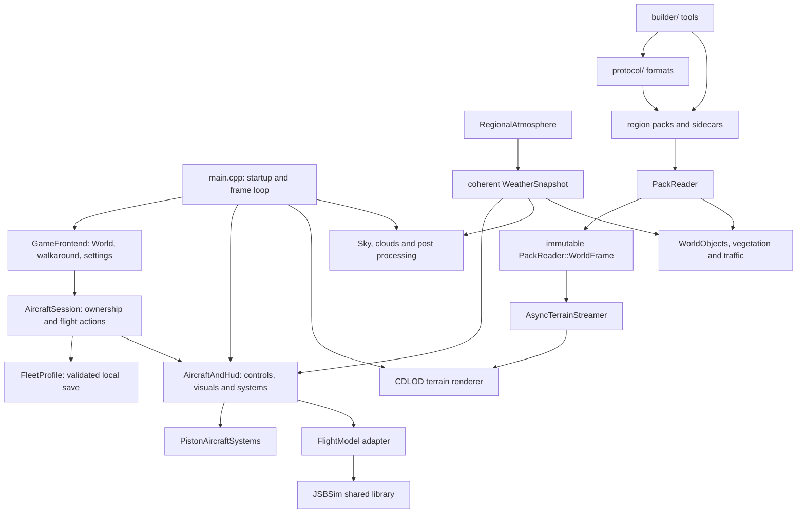

# Architecture

This guide explains how the game is divided and how a flight moves through the runtime. For individual file responsibilities, see [file reference](FILE_REFERENCE.md). For operational details of the subsystems, see [systems](SYSTEMS.md).

## Product model

OpenSky is a VFR free-roam sandbox. A player owns one aircraft, initially the Cessna 172S, and discovers the installed world by flying from Castejón de Sos (`ES-0205`). Browsing the World screen, selecting airports, and making routes are read-only with respect to aircraft position. Landing does not immediately establish a base: the player must park clear of the runway. Only successful parking updates the saved base. If the player leaves before parking, the previous saved stand remains the next starting point.

The profile persists aircraft location, heading, condition, fuel, route and logbook. Flight dynamics advance at 120 Hz. Rendering, frame-rate caps and GPU uploads do not advance JSBSim independently.

## Runtime map

## Runtime ownership

### Application and window

`sim_engine/src/main.cpp` owns startup, pack selection, the simulation clock, region transitions, worker coordination, frame pacing and render order. `PlatformWindow` owns the native window, OpenGL context, input events and presentation surface. The supported native path is Linux/X11/GLX.

`GameFrontend` builds the World, logbook, settings, controls, walkaround, navigation and replay interfaces. It sends explicit requests such as `Walk`, `Board` and `Park`; it does not own the flight dynamics model. `AircraftSession` validates those actions against the ownership rules and uses `FleetProfile` to persist state.

### Aircraft simulation

`SimulationClock` accumulates elapsed wall time and releases whole JSBSim steps. Its maximum per-frame accumulation is bounded to 50 ms; excess wall time is dropped rather than passed as a variable-sized physics step. `AircraftAndHud` samples local weather and controls, updates piston systems, supplies engine and environment inputs to `FlightModel`, and reads back the JSBSim state.

The project adapter in `engine/src/flight_model_jsb.cpp` owns one JSBSim executive, binds the aircraft and engine files from an aircraft package, applies the fixed step, transfers weather and engine values, and resolves contacts through the scenery ground callback. JSBSim itself remains a separate dynamically linked dependency.

The game-facing piston systems are in `engine/src/c172_systems.cpp`. They model fuel selection, electrical buses, starter, mixture, oil, carburetor ice, wear, and other supported C172-style systems. The current moddable aircraft profile is intentionally limited to one piston engine, one propeller, two fuel tanks and at least three gear units.

### World data and terrain

`PackReader` reads the shared pack protocol, indexes airports, places, roads, runways, imagery and elevation, and creates immutable `WorldFrame` snapshots for terrain jobs. The terrain worker pool consumes a frame snapshot instead of mutable region state. The main thread validates transition generations before publishing completed work, so stale results cannot replace the active world after a region change.

`AsyncTerrainStreamer` prioritizes pages by aircraft distance and view demand. Workers prepare terrain pages for a bounded number of uploads each frame. L7–L9 pages carry nearby detail, and coarser pages cover the horizon. `PackReader` streams IGN PNOA separately from terrain work. The nearest L9 pages can use Z20 source tiles, with installed imagery available while downloads finish. Each page records the download revision it sampled, so a download that completes during a page build can still trigger an in-place refresh. The render loop throttles those refreshes and prioritizes recently visible pages.

`CdlodTerrain` draws height and surface data using the active quality tier. When the draw budget runs low, the traversal keeps coarser patches to cover the remaining terrain. The engine recenters the world asynchronously before the aircraft reaches the edge of its terrain grid. World-menu topography uses baked `.relief.png` sidecars with a shared palette, uploaded once with mipmaps. Relief sidecars are distinct from flight-scene PNOA imagery.

### Weather data flow

The weather worker consumes fixed inputs, terrain and a world-frame domain, advances its regional grid, then publishes one coherent `WeatherSnapshot`. The snapshot includes region/domain coverage, source, generation and solved simulation time. Consumers use a snapshot instead of reading partially solved worker buffers. A new domain or region generation invalidates results from the old one.

The World menu history and outlook read published model snapshots. Open-Meteo is an optional live boundary input. The worker evolves the local in-game weather; the UI does not present raw provider data as if it were a solved in-game history. Full details and the current resolution limit are in [weather system](WEATHER.md).

### Rendering order

The frame renderer prepares the camera, quality tier and streamer requests, draws sky and terrain, then static world objects and dynamic traffic/aircraft. Cloud occlusion and reduced-resolution volumetric clouds are composed before final output. When native cockpit rendering is active, the cockpit model is drawn at output resolution after exterior reconstruction. HUD and interface rendering occur last and are kept separate from the physical cockpit model.

The renderer consumes the most recently published aircraft and weather state. Rendering is not a second simulation clock. Expensive sky/reflection updates are bounded by weather changes or a low update frequency, while terrain and city uploads follow frame budgets.

## Content pipeline

`builder/` creates region packs from licensed source data. `protocol/pack_format.*` defines `.nspack`; `protocol/weather_format.*` defines `.nswx`. Optional companions include `.relief.png`, `_cities.nscity`, `_city_sh.nsshd` and `_scenery.nsscn`. Installed readers are part of the runtime contract, so retiring a producer does not remove support for existing pack data without a format migration.

The release baseline is one complete game containing both Aragón and Catalunya. Users can install compatible region packs under their user data directory. Generated packs, downloaded imagery, caches, screenshots and temporary bakes must stay outside tracked source.

## Change guidance

- Put aircraft ownership and parking rules in `AircraftSession`; avoid moving state from map selection or UI helpers.
- Keep simulation timing in `SimulationClock` and JSBSim's fixed-step adapter; do not advance flight time from render code.
- Carry immutable world-frame and generation tokens through terrain and weather work; reject old results before publication.
- Keep C++ and Python pack changes together in `protocol/`, and preserve readers for already-installed data.
- Keep downloaded or generated content outside the source tree, with source attribution and licenses retained.
- See [contributing](../CONTRIBUTING.md) and the dated [engine audit](2026-11-23_opensky-engine-audit.md) for current engineering constraints and verification evidence.
