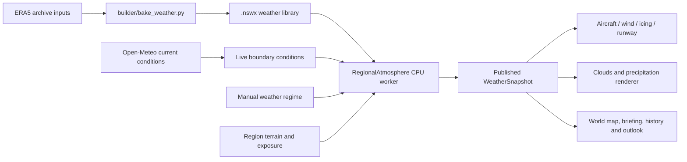

# Weather system

OpenSky weather is a regional in-game model. The World screen's “now” and history values describe the latest **published model snapshot**, not a direct readout of a remote feed. Open-Meteo can provide live boundary conditions; the local solver evolves the conditions that are then used by flight dynamics, clouds, surface wetness and airport/route briefings.

## Data flow

### Baked library

`builder/bake_weather.py` converts licensed historical climate input into a compact regional `.nswx` library. The current Aragón library is based on ERA5 archive data from 2024 and samples five corridor locations into 220 baked states. It provides a local fallback and source metadata; it is not a live forecast and does not have observation-level resolution.

`protocol/weather_format.h` defines the C++ representation and `protocol/weather_format.py` writes the matching format. `WeatherLibrary` reads those records and exposes provenance to the model and UI. Keep both implementations compatible when changing the format.

### Live boundary input

When live mode is enabled, the weather client requests current conditions from Open-Meteo near the aircraft. The fetched conditions initialize or refresh the model's regional boundary input; they are not copied directly into every airport cell. A successful fetch is refreshed periodically; on failure or stale data the simulator falls back to installed baked weather. See [Open-Meteo documentation](https://open-meteo.com/en/docs) for current feed and attribution terms.

### CPU model and snapshots

`RegionalAtmosphere` runs a **384 × 288 × 4** CPU field with a nominal 0.25-second model step. Its four terrain-following layers are approximately 10, 550, 1,800 and 4,500 m above ground. Across the default corridor, horizontal spacing is roughly 400–430 m per cell, depending on latitude and domain extent.

The model evolves wind, temperature, moisture/cloud, turbulence and precipitation fields. Terrain exposure affects orographic uplift and sheltering. The renderer uploads a weather field to a 2D-array texture and samples it for clouds, wind, rain and related effects. Smaller texture or shader details improve visual sampling; they do not increase the CPU model's true spatial resolution.

The worker writes private solve buffers. Consumers read a published snapshot that includes its domain, input source, generation and solved simulation time. A domain change increments the generation; results from an old region are discarded before publication. This keeps the aircraft, renderer and World menu on a coherent weather state.

## Player-facing weather

- **Airport briefing:** samples the active model at the selected airport and reports local wind, temperature, pressure, cloud and precipitation when that point is covered.
- **Map overlay:** visualizes the current field on the World map. Layer values are interpolated from the active model grid.
- **History:** displays previously published states and their source/region/time. It must not imply that an un-solved boundary fetch was a past regional solve.
- **Outlook:** runs a separate model projection at +1, +3 and +5 simulation minutes with its current boundary inputs held fixed. The outlook is a short in-game projection, not a remote forecast.
- **Coverage:** an airport outside the model domain is labelled as uncovered. Do not silently extrapolate a precise briefing beyond the active domain.

When live conditions are not available, UI labels identify the baked, manual or default source. Attribution and provider terms are in [third-party licenses](../THIRD_PARTY_LICENSES.md).

## Weather and aircraft behavior

The local sample supplies wind, temperature, humidity, pressure and turbulence to the JSBSim adapter. Precipitation and icing also influence surface grip, windshield effects and aircraft condition. The aircraft systems can model carburetor icing, pitot blockage and water contamination in fuel sumps.

### Parked exposure and engine symptoms

The piston systems deliberately produce periodic power sputter when stored fuel-sump water exceeds its threshold. The model currently pulses the engine-power multiplier on a roughly four-second cycle and exposes an in-cockpit caution. A render hitch alone does not set sump water or directly create this power multiplier.

Rain may affect a parked aircraft's condition during exposure. Opening a walkaround during rain no longer adds sump water on its own; contamination accrues through the existing prolonged-exposure path. Already-contaminated saves can still be drained at the walkaround sump station. If an engine begins sputtering, inspect the in-flight caution and fuel-sump condition before diagnosing a graphics stall.

## Resolution and known limits

The 384 × 288 × 4 field is a mesoscale model for a regional corridor, not a high-resolution weather radar. A default cell spans hundreds of metres; narrow valley gusts and sharp boundaries can therefore be smoothed. Cloud-noise detail can make the sky look more intricate than the physical wind field actually is.

The model currently has a small number of vertical levels and simplified exchanges, pressure balance and precipitation. Its live regional boundary may miss fronts or differences across the Pyrenees. Baked precipitation is an estimate. Use the dated [flight/weather audit](2026-11-23_flight-weather-audit.md) for the current validation gaps and measurement history.

To improve flow readability without misrepresenting physics, first separate visual vector density from solver resolution. For true finer weather cells, measure worker time, publication backlog, memory and texture upload cost before increasing grid width/height; keep background solves off the render thread. Compare wind, temperature, cloud base and precipitation against time-matched observations or published regional model fields before calling the result realistic.

## Files to change

| Change | Primary files |
|---|---|
| Bake weather library or change source metadata | `builder/bake_weather.py`, `protocol/weather_format.py` |
| Change binary layout | `protocol/weather_format.h`, `protocol/weather_format.py`, `sim_engine/src/weather_library.*` |
| Change solver dynamics, cadence or region generation | `sim_engine/src/regional_atmosphere.*` |
| Change atmospheric sampling consumed by the aircraft | `sim_engine/src/aircraft_hud.cpp`, `engine/src/flight_model_jsb.cpp`, `engine/src/c172_systems.cpp` |
| Change cloud/rain field rendering | `sim_engine/src/volumetric_clouds.*`, related `sim_engine/shaders/` files |
| Change map weather, history, source and coverage labels | `sim_engine/src/game_frontend.cpp`, `sim_engine/shaders/frontend.frag` |

Keep the player-facing source label, snapshot generation/domain, and published solved time coherent whenever the model changes. Do not expose live raw input as historical model output.
